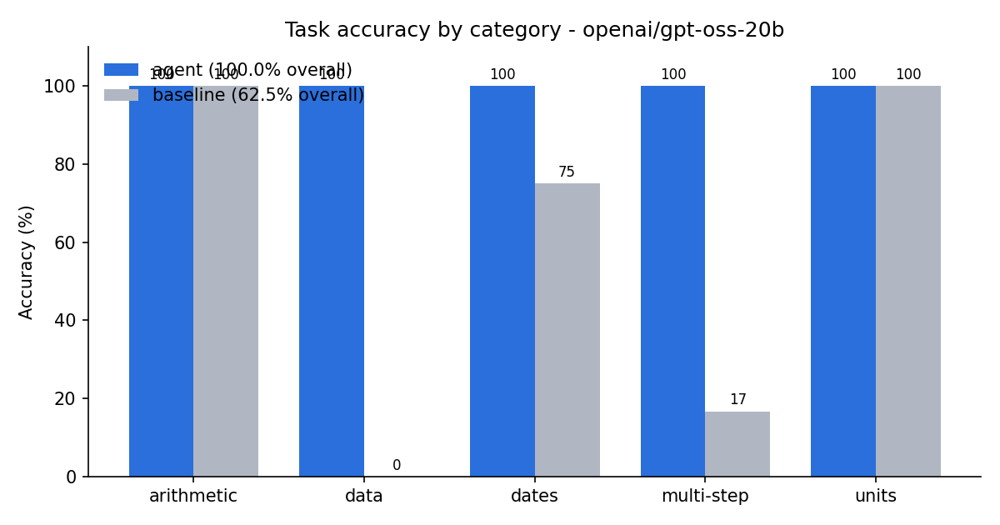

# Evaluation Report: Tool-Using LLM Agent

*Model:* `openai/gpt-oss-20b`  |  *Backend:* `openai`  |  *Run:* 2026-10-24 12:20:26

## 1. Headline results

- Tool-using agent accuracy: **100.0%** vs **62.5%** for the same model without tools (**+37.5 percentage points**, 1.6x).
- Benchmark: 40 tasks across 5 categories.
- Tool calls per task: 1.23; tool-error rate 2.0%; 1/1 runs that hit a tool error still reached the correct answer (self-correction).
- Average cost: ~1428 tokens and 5.85s per task (p95 9.95s). Crashes: 0.

## 2. Overall metrics

| Metric | agent | baseline |
|---|---|---|
| Accuracy (%) | 100.0 | 62.5 |
| Avg LLM steps | 2.23 | 1.07 |
| Avg tool calls | 1.23 | 0.0 |
| Tool error rate (%) | 2.0 | 0.0 |
| Avg tokens / task | 1428 | 824 |
| Avg latency (s) | 5.85 | 5.78 |
| p95 latency (s) | 9.95 | 15.57 |
| Crashes | 0 | 0 |

## 3. Accuracy by category

| Category | agent | baseline |
|---|---|---|
| arithmetic | 100.0 | 100.0 |
| data | 100.0 | 0.0 |
| dates | 100.0 | 75.0 |
| multi_step | 100.0 | 16.7 |
| units | 100.0 | 100.0 |

## 4. Failure analysis (agent mode)

The agent answered every task correctly.

## 5. Method

- **Agent loop** (`agent/core.py`): the model receives JSON-schema tool definitions via native function calling, emits tool calls, observes results and iterates until it outputs `FINAL ANSWER:` or hits an 8-step budget. Malformed JSON and tool exceptions are returned to the model as errors so it can retry.
- **Tools** (`agent/tools.py`): AST-sandboxed calculator, date arithmetic, unit conversion, and a query tool over a private sales CSV (data the model cannot know).
- **Baseline:** identical model and prompt format, but no tools.
- **Scoring:** numeric answers correct within 0.1% relative (or 0.01 absolute) tolerance; text answers case-insensitive exact match. Ground truth is generated by executing reference tool plans, so labels are exact.

## 6. Limitations

- 40 tasks is a small benchmark; differences of a few points are within noise.
- Results depend on the model; smaller local models make more malformed tool calls.
- Data-lookup tasks are unanswerable without tools by design, which inflates the gap in that category.
